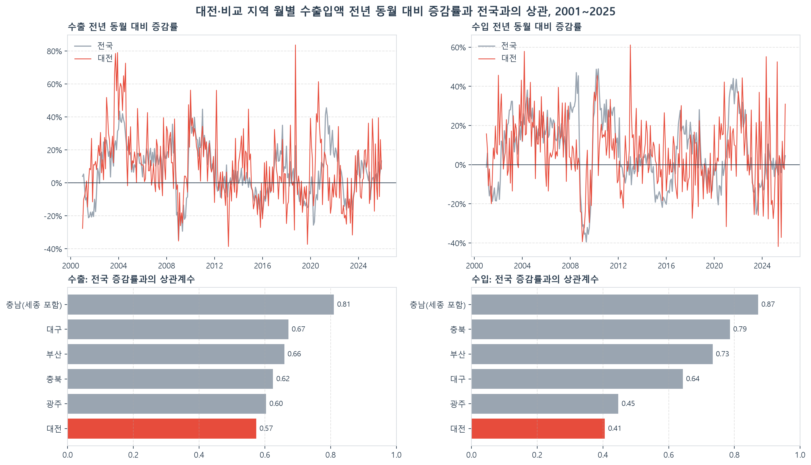
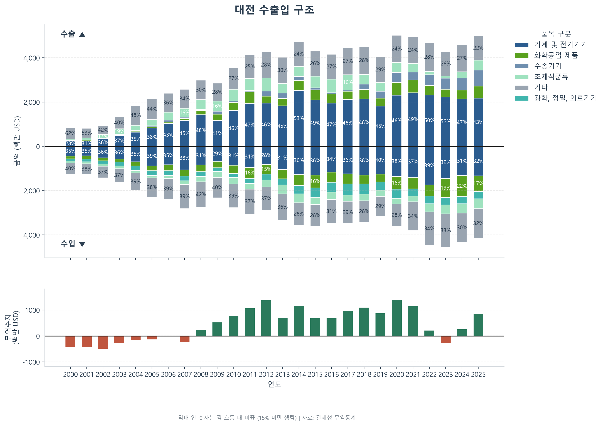
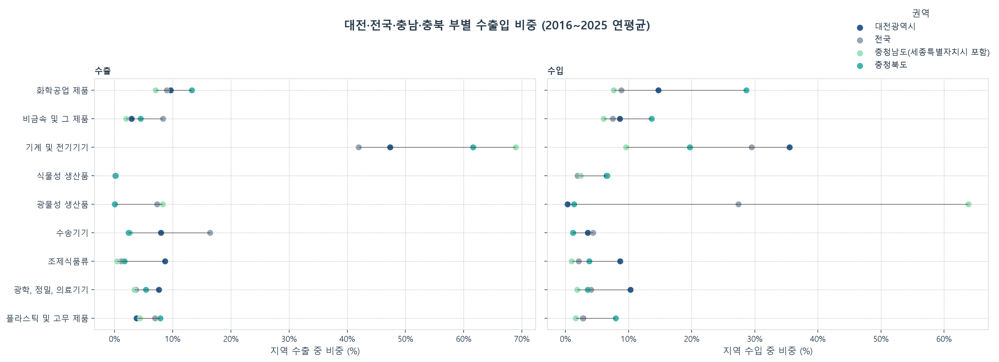
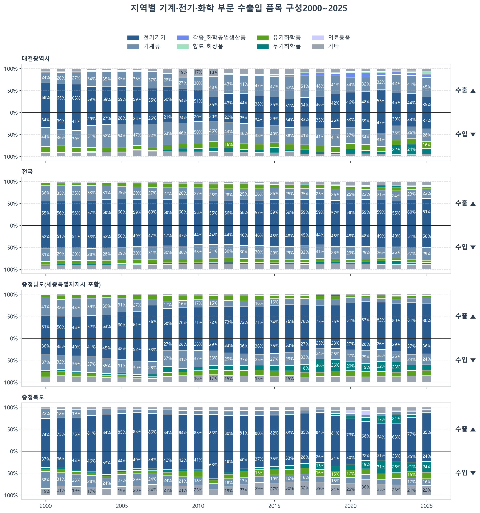
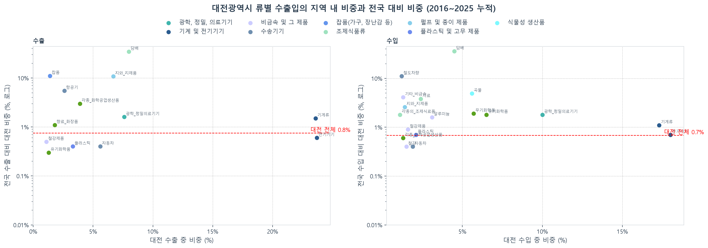
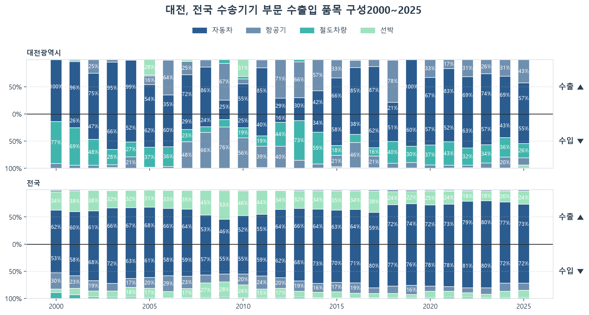
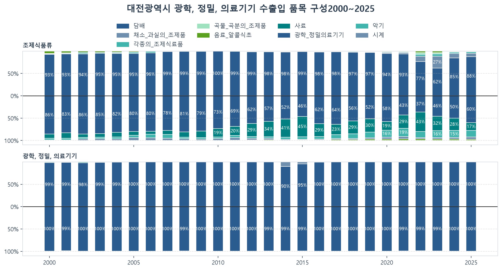
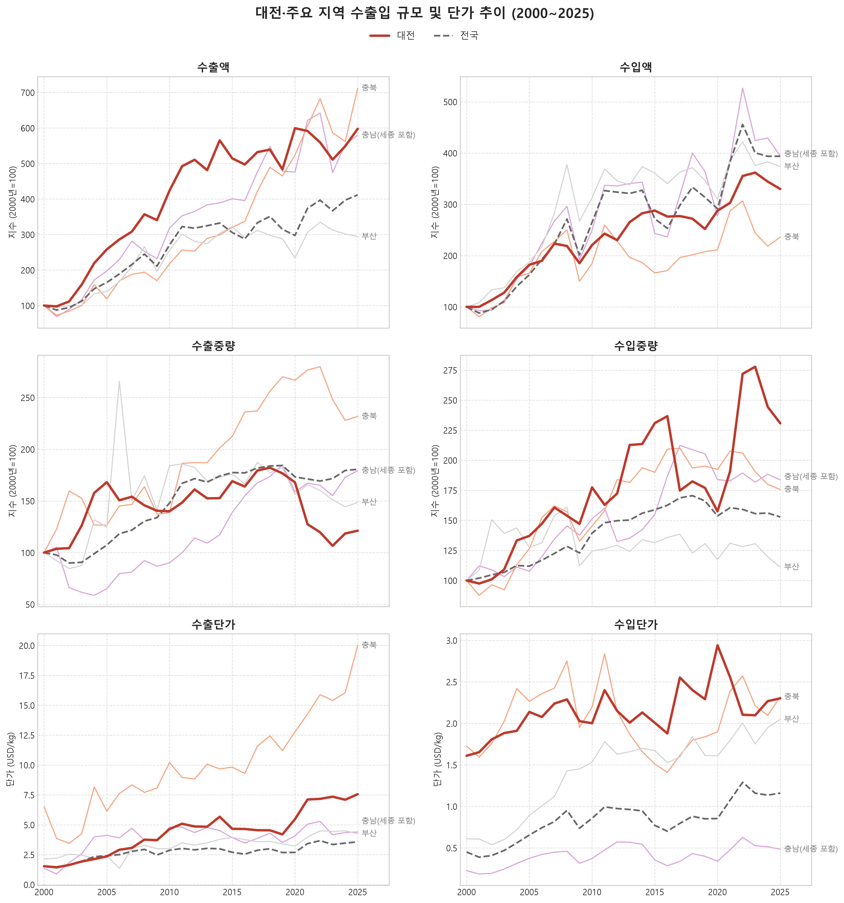
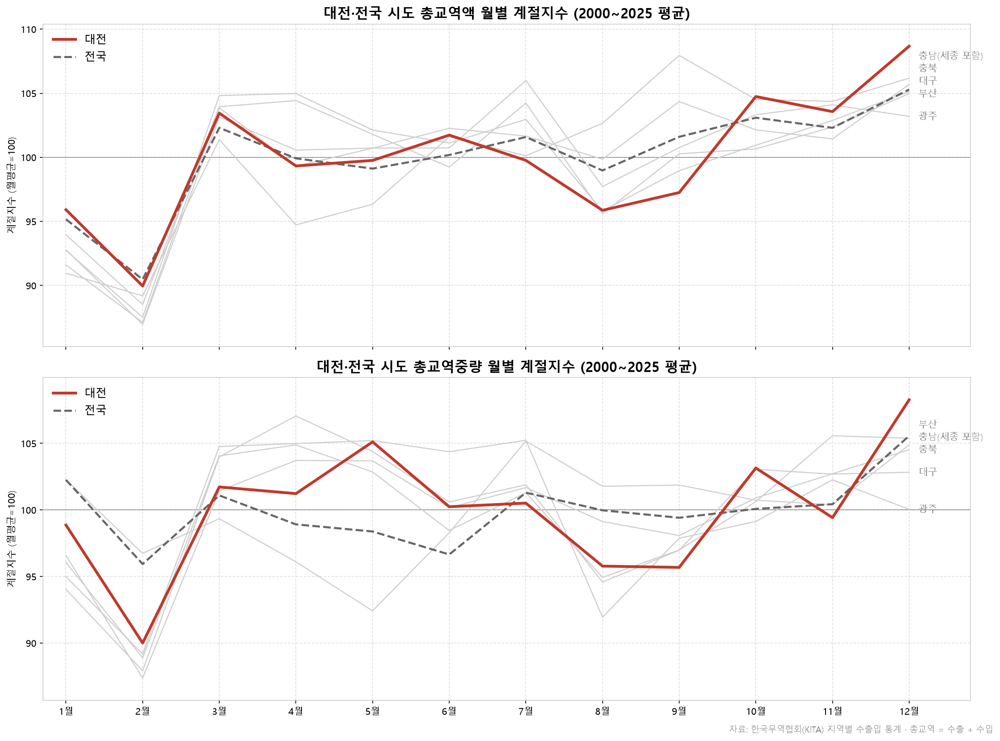

# 대전의 수출입 구조와 물류 함의

**요약:** 공개 무역통계(관세청, 한국무역협회 K-stat)로 대전이 무엇을 수출하고 수입하는지, 2000년 이후 화물의 성격이 어떻게 바뀌었는지, 그 화물이 물류에 무엇을 요구하는지 분석했다. 대전을 전국, 충청권, 비슷한 규모의 광역시와 비교했다.

**주제선정 이유:** 부산·인천 같은 항만도시나 수도권은 물동량 자체가 커서 한국 전체의 무역 흐름을 따라갈 가능성이 높다. 대전은 내륙에 있으면서도 제주처럼 고립되지 않은 도시이므로, 지역 특성이 무역 구조에 더 잘 드러날 것이라고 보았다. 

분석 결과 이 가정은 절반만 맞았다. 대전은 비교 지역 중 전국 흐름을 가장 덜 따르지만([핵심 결과 1](#1-대전은-비교-지역-중-전국-흐름을-가장-덜-따른다)), 그 차이의 일부는 지역 산업이 아니라 대전에 본사를 둔 기관·기업에서 나온다([핵심 결과 4](#4-일부-품목은-대전-산업이-아니라-본사-소재지를-반영한다)).

**진행 상황**: 수집·정제·검증 파이프라인과 HS 류 단위 분석 완료. HS 4단위 세부 분석은 [남은 질문](#남은-질문) 참고.

## 핵심 결과

> 별도 표기가 없으면 관세청 무역통계, 2016~2025년 10년 평균 기준. 1, 8, 9번은 K-stat 월별·연도별 자료.

### 1. 대전은 비교 지역 중 전국 흐름을 가장 덜 따른다

월별 수출입액의 전년 동월 대비 증감률을 지역마다 구하고, 전국 증감률과의 상관계수를 비교했다(2001~2025년). 전월 대비 변화가 아니라 전년 동월 대비를 쓴 이유는 계절성과 영업일 수 차이를 제거하기 위해서다.

| 지역 | 수출 | 수입 |
|---|---|---|
| **대전** | **0.57** | **0.41** |
| 광주 | 0.60 | 0.45 |
| 충북 | 0.62 | 0.79 |
| 부산 | 0.66 | 0.73 |
| 대구 | 0.67 | 0.64 |
| 충남(세종 포함) | 0.81 | 0.87 |

대전은 수출과 수입 모두 상관계수가 가장 낮다. 다만 광주와의 차이는 작으므로, "대전만 특별하다"기보다 "대전과 광주는 전국 흐름과 거리가 있는 편"으로 읽는 것이 정확하다. 



### 2. 대전은 2008년부터 전국과 다른 무역수지 흐름을 보인다

| 구간 | 대전 | 전국 |
|---|---|---|
| 2000~2007 | 적자 (2006년만 소폭 흑자, 6백만 USD) | 매년 흑자 |
| 2008~2025 | 2023년을 제외하고 매년 흑자 | 2008, 2022, 2023년 적자 |

전국이 적자였던 2008년과 2022년에 대전은 흑자였다(교역액 대비 무역수지 2008년 +4.1%, 2022년 +2.3%). 반대로 2023년에는 대전의 적자율(−3.1%)이 전국(−0.8%)보다 컸다. 대전의 무역수지는 전국 흐름과 따로 움직인다.



### 3. 대전의 품목 구성은 전국·충청권과 다르다



- **기계 및 전기기기**는 대전 수출의 47.4%로 전국(42.0%)보다 높지만, 반도체 중심인 충남(68.9%)·충북(61.6%)보다는 낮다. 수입에서는 대전(35.7%)이 네 지역 중 가장 높다. 세부적으로는 전기기기보다 **기계류** 비중이 높다(TD_6).
- **조제식품류**(수출·수입 각 8%)와 **광학·정밀·의료기기**(수입 9.7%)는 전국보다 훨씬 높다.
- **광물성 생산품**(원유·석탄 등)은 전국 수입의 28.1%, 충남 수입의 65%지만 대전은 0.3%다. 항만·정유 시설이 없는 내륙 도시의 특징이다.
- 대전의 **무기화학품** 수입은 2022년 1.2억 USD에서 2023년 5.0억, 2024년 5.4억 USD로 늘어 대전 전체 수입의 11~13%를 차지했다가, 2025년 2.5억 USD(6.1%)로 다시 줄었다. 2015년과 2020년에도 비슷한 일시적 증가가 있어, 꾸준한 증가보다는 특정 연도의 대량 수입으로 보인다.



### 4. 일부 품목은 대전 산업이 아니라 본사 소재지를 반영한다

대전은 전국 수출의 0.75%, 수입의 0.68%를 차지한다. 대전 교역에서 1% 이상을 차지하는 류 중 전국 대비 비중이 이 기준선보다 크게 높은 류는 다음과 같다.

| 류 | 대전 수출 중 비중 | 전국 수출 중 대전 비중 | 대전 수입 중 비중 | 전국 수입 중 대전 비중 |
|---|---|---|---|---|
| 담배 | 8.0% | 34.7% | 4.5% | 35.9% |
| 잡품 | 1.4% | 11.1% | 0.2% | 0.6% |
| 지와 지제품 | 6.7% | 10.8% | 1.4% | 2.6% |
| 항공기 | 2.6% | 5.5% | 0.5% | 0.6% |
| 철도차량 | 0.0% | 0.1% | 1.2% | 11.1% |
| 곡물 | 0.0% | 0.0% | 5.6% | 4.9% |



지역별 수출 실적은 신고서에 제조 장소가 없으면 **본사 소재지**로 집계된다([헤럴드경제, 2026](https://www.heraldk.com/article/2026012717375012007)). 대전에는 전국 단위로 거래하는 기관·기업의 본사가 있다.

- **담배:** KT&G 본사와 신탄진 공장이 대전에 있다. 한 기업이 수출과 수입을 모두 담당하므로 전국 대비 비중이 양쪽 모두 약 35%로 비슷하게 나온다. 조제식품류 비중(8.7%)의 대부분이 담배(8.0%)다.
- **철도차량:** 한국철도공사와 국가철도공단 본사가 대전에 있다. 2013년 철도차량 수입(1.17억 USD)은 대전의 도시 확장보다 전국 단위 차량 도입이 대전 실적으로 잡혔을 가능성이 높다.
- **잡품, 지와 지제품, 곡물:** 아직 설명하지 못했다([남은 질문](#남은-질문)).

따라서 대전의 무역 구조를 대전의 산업 구조로 바로 읽을 수 없다. 핵심 결과 1의 낮은 상관계수도 일부는 이런 본사 집계 품목에서 나왔을 수 있다.

### 5. 수송기기 수출은 항공기 때문에 해마다 크게 흔들린다

| 연도 | 2017 | 2018 | 2019 | 2020 | 2025 |
|---|---|---|---|---|---|
| 수송기기 수출 (백만 USD) | 46 | 239 | 315 | 448 | 735 |
| 그중 항공기 비중 | 13% | 78% | 0% | 33% | 43% |

대부분의 해에는 자동차가 수송기기 수출의 절반 이상을 차지하지만, 전국 대비 비중은 항공기(5.5%)가 자동차보다 높다. 항공기 수출은 연간 신고 13\~44건에 금액 변동이 커서, 소수의 고가 품목이 일부 연도에만 인도되는 패턴으로 보인다. HS 88류에는 항공기뿐 아니라 **인공위성**(8802.60)도 포함되므로, 4\~6단위 확인이 필요하다([남은 질문](#남은-질문)).



### 6. 수입은 소량·다빈도로 바뀌고 있다

관세청 시도별 수출입실적 API 기준:

| 2020 → 2025 | 수출 | 수입 |
|---|---|---|
| 신고 건수 | 96,354 → 85,389건 (−11.4%) | 717,934 → 1,298,568건 (**+80.9%**) |
| 금액 | 50.2억 → 50.0억 USD (−0.3%) | 36.2억 → 41.5억 USD (+14.7%) |
| 건당 금액 | 52,081 → 58,610 USD (+12.5%) | 5,044 → 3,198 USD (**−36.6%**) |

수입은 금액보다 건수가 훨씬 빠르게 늘어 건당 금액이 3분의 1 넘게 줄었다. 소액 전자상거래(직구) 화물이 늘었을 가능성이 있지만, 가공단계별 자료로 확인하기 전까지는 해석을 보류한다.

### 7. 광학·정밀·의료기기 수입 비중이 높다

광학·정밀·의료기기는 대전 수입의 10.3%로 전국(4.1%)의 2.5배다. 대덕연구단지·KAIST 등 연구기관이 많은 도시 특성상 **측정·분석·시험기기** 수입일 가능성이 있다. 의료기기인지 연구장비인지는 HS 4단위(9018 의료기기 vs 9027·9030·9031 분석·측정기기)로 나눠 확인한다.



### 8. 대전 수출은 2020년 이후 가벼워지고 비싸졌다

K-stat 연도별 기준:

| | 2018~2019 평균 | 2023~2025 평균 | 변화 |
|---|---|---|---|
| 대전 수출중량 (천 톤) | 980 | 630 | −36% |
| 대전 수출단가 (USD/kg) | 4.4 | 7.4 | +69% |
| 전국 수출단가 (USD/kg) | 2.9 | 3.5 | +23% |

- 같은 기간 수출 금액은 약 9% 늘었을 뿐인데 중량이 3분의 1 넘게 줄어, kg당 가치가 크게 올랐다. 대전의 수출단가는 2005년까지 전국과 비슷했고(2.4 vs 2.4 USD/kg), 2010년 무렵부터 전국보다 높아졌으며, 2020~2021년에 격차가 다시 크게 벌어졌다(2019년 1.6배 → 2021년 2.1배).
- 수입단가는 대전이 꾸준히 전국의 약 2배다(2025년 2.3 vs 1.2 USD/kg). 원유·석탄 같은 무겁고 싼 원자재를 거의 수입하지 않기 때문이다(핵심 결과 3).
- 물류 측면에서는 대전 화물이 부피·중량보다 **가치 대비 보안·취급**이 중요한 화물에 가깝다는 뜻이다.



### 9. 계절성: 연초·8월 수출이 낮고 연말이 높다

연도별 월평균을 100으로 둔 대전의 월별 지수(2000~2025년 평균):

| 월 | 1 | 2 | 3 | 4 | 5 | 6 | 7 | 8 | 9 | 10 | 11 | 12 |
|---|---|---|---|---|---|---|---|---|---|---|---|---|
| 수출 | 91 | 90 | 105 | 97 | 99 | 104 | 99 | 93 | 101 | 106 | 106 | 109 |
| 수입 | 98 | 88 | 101 | 101 | 102 | 100 | 99 | 99 | 93 | 104 | 103 | 112 |

1~2월(설 연휴)과 8월(여름휴가)에 수출이 낮고, 3월과 10~12월에 높다. 수입은 2월과 9월에 낮고 12월에 가장 높다. 2월 하락의 상당 부분은 일수(28일) 차이에서 오며, 9월 하락은 추석 연휴의 영향으로 보이나 추석이 9~10월을 오가므로 연도별 확인이 필요하다.



## 이전 버전: 국내 화물 O/D 분석

처음에는 국가물류통합정보센터(NLIC) 화물 O/D 자료로 대전의 국내 물류를 분석했다. 대전 출발 물동량이 2021년 1,030만 톤에서 2022년 430만 톤으로 58% 줄어, 이를 "B2B 중계 기능 소멸"로 해석했다.

그러나 같은 해 전국 총 물동량은 3%만 줄어든 반면, 지역별 출발 물동량은 서울 +113%, 강원 +42%, 대구 −38%, 세종 −39%로 모든 지역이 동시에 크게 변했다. NLIC의 화물 O/D는 국가교통DB(KTDB)의 추정 자료를 재공표한 것으로, NLIC는 "해당 자료는 국가교통DB로부터 2022년 자료까지 제공되고 있음"이라고 명시하고 있다. 단절이 KTDB 자료의 마지막 제공 연도인 2022년에 나타나므로, 실제 경제 변화라기보다 KTDB의 추정 기준이 바뀌어 시계열이 끊겼을 가능성이 높다. 다만 KTDB의 추정 방법 변경 여부는 공식 문서로 확인하지 못했다.

NLIC 자료는 국내 화물 분석의 중심이었기 때문에, 단절 여부를 확인할 수 없는 상태에서는 어떤 결론도 내릴 수 없었다. 그래서 국내 화물 분석을 중단하고, 주제를 "지역 특성과 국내 화물"에서 "지역 특성과 무역 구조"로 바꿨다. 자료는 지역 합계를 서로 교차 검증할 수 있는 관세청·무역협회 무역통계로 정했다. 이 프로젝트에서 검증 단계를 많이 둔 이유다.

## 분석 질문

1. **무엇이 들어오고 나가는가, 어떻게 바뀌었는가:** HS 류 단위 수출입 구성
2. **화물의 물리적 성격은 어떻게 달라졌는가:** 중량과 단위가치(USD/kg)
3. **계절성이 있는가:** 월별 계절 패턴
4. **이 구조가 요구하는 물류 역량은 무엇인가**

## 데이터

| 출처 | 내용 | 범위 | 용도 |
|---|---|---|---|
| 한국무역협회 K-stat (지자체 수출입) | 지역별 금액, **중량**, 수지 | 월별, 2000-01 ~ 2026-08 | 중량, 단가, 계절성, 전국과의 상관 |
| 관세청 무역통계 (지역별 실적) | HS 2단위(류)별 금액, 신고 건수 | 연도별, 2000 ~ 2025 | 수출입 품목 구성 |
| 관세청 시도별 수출입실적 API | 대전 금액, 신고 건수 | 2020 ~ 2025 | 건수·건당 금액 |
| 관세청 조회코드표, HS 부호 | 시도코드, HS 부/류 명칭 | | 지역·품목 라벨 |
| KOSIS 전국사업체조사, 광업제조업조사 | 산업별 사업체수, 종사자수, 매출액 | 2021 ~ 2024 | 배경: 대전 산업 구조 |

시도 단위 **중량**을 공개하는 곳은 K-stat뿐이고, **HS 품목 구성**은 관세청 자료에만 있다. 두 자료를 함께 쓰는 이유이며, 두 자료의 합계가 일치하는지 교차 검증했다([검증](#검증) 참고).

**분석 기간은 2000~2025년이다.** K-stat은 2026년 8월까지 받았지만 2026년은 모든 지역에서 부분 연도이므로 연간·계절 분석에서 제외한다.

### 컬럼 정의

| 컬럼 | 정의 |
|---|---|
| `수출비중`, `수입비중` | 해당 **지역·연도**의 수출(수입) 총액 중 해당 류가 차지하는 비중(%). 지역 간에 더하거나 평균하지 않는다. 지역을 합칠 때는 금액을 먼저 합산한 뒤 다시 계산한다 |
| `수출건수`, `수입건수` | 류별 신고 건수. 한 신고서에 여러 류가 있으면 각 류에 모두 집계되므로 **류 간에 더할 수 없다**. 지역 전체 건수는 시도별 API 값을 쓴다 |
| `무역수지` | 수출금액 − 수입금액 (천 USD) |
| `원자료없음` | 원자료에 행이 없어 0으로 채운 격자 행 |

단위: K-stat 원자료는 천불·kg, 정제 파일은 백만불·천톤(컬럼명에 단위 표기). 관세청 금액은 천불. 단가(USD/kg)는 단위 변환 전 원자료 단위로 계산했다.

### 제외한 류

- **99류**(분류 불명 물품): 품목 구성 분석에서 제외.
- **77류:** 국제 HS 품목표상 유보(reserved) 류로 해당 품목이 없다. 원자료에 1건(서울 2004년 수출 1건, 4천 달러)이 있으나 분류 오류로 보고 99류와 함께 제외했다. 병합 파일에는 원자료 그대로 보존했다.

### 배경 자료 유의사항
- **전국사업체조사:** 2020년은 조사 시기가 달라(6~7월 35일 vs 2~3월 25일) 제외하고, 조사 조건이 같은 2021년을 기준연도로 사용한다. 사업체 단위 통계이므로 기업체 단위 통계와 일치하지 않을 수 있다.
- **광업제조업조사:** 10인 이상 사업체 대상. 2020년은 경제총조사 실시연도로 조사 주체가 달라 제외한다.
- **단년도 기준의 타당성:** 도입부 차트(09)는 2024년 단일 연도 기준이다. 4년 평균 기준과 비교하면 선정 산업 집합이 완전히 같고, 제조업 격차의 표준편차는 0.19%p로 단년도 노이즈는 작다. 재현: `python src/core/validate_data.py gap_stability`

## 분류 체계

품목 분류는 HS(HSK)를 기준으로 한다. 관세청 자료와 류 단위로 바로 결합되고, 필요하면 4·6단위까지 내려가 품목을 확인할 수 있기 때문이다. MTI는 라벨이 읽기 쉬워 대전시·무역협회 자료와 대조할 때만 참고하며 본문에 섞지 않는다. SITC는 국제 비교용이므로 사용하지 않는다.

## 비교 지역

대전을 두 그룹과 비교하고, 전국을 기준선으로 둔다.

- **규모 그룹(광주, 대구, 부산):** 2025년 수출액이 대전의 0.2~5배인 광역시. *대전의 화물 구조는 비슷한 규모의 도시와 비교해 전형적인가?*
- **인접 그룹(충남, 충북, 세종):** 도로·철도·항만 접근을 공유하는 충청권. *같은 물류권 안에서 대전은 어떻게 다른가?* 충남·충북은 인접성 기준으로만 포함했으며, 충남은 자체 항만(당진, 대산)을 갖고 있다.

규모가 아니라 구조(단가, 중량비, HS 비중, 계절 패턴)를 비교하고, 그룹 평균 대신 지역을 나란히 보여준다(합계를 내면 충남이 사실상 전부를 차지한다).

### 지역 정의

관세청 자료의 `지역명`은 원자료 표기(예: 충청남도)를 그대로 쓰고, K-stat은 약칭(충남 등)을 쓴다. 대응표는 `src/core/regions.py`에 있다.

최종 파일(`_4_added`)에는 충남 관련 지역이 세 가지 있다.

| 지역명 | 의미 |
|---|---|
| 충남 | 원자료 그대로. K-stat은 2012년 6월까지 연기군(현 세종)을 포함 |
| 세종 | 원자료 그대로. K-stat은 2012년 7월부터, 관세청은 2000년부터(현재 행정구역을 과거 연도에 소급 적용) |
| 충남(세종 포함) | 충남 + 세종. 이 프로젝트에서 추가. 모든 연도·두 자료에서 같은 범위 |

사용 기준:

- 2013년 이후만 다루는 차트 → 충남, 충북, 세종을 각각 표시
- 2012년 이전을 포함하는 차트 → 충남(세종 포함), 충북
- `core.regions.adjacent_regions(first_year)`가 기간에 맞는 지역 목록을 반환한다.

**충남(세종 포함)을 충남이나 세종과 더하지 말 것.** 세종이 두 번 집계된다.

광주는 2026년 7월 전남광주통합특별시로 통합되었으나, 분석 기간(~2025년)에는 광주광역시 단위로 집계되므로 통합 이전 기준을 그대로 사용한다.

## 파이프라인

모든 스크립트는 프로젝트 루트에서 실행한다(`python src/<스크립트>.py`). 각 단계는 이전 단계의 출력을 읽는다.

### K-stat

| 순서 | 스크립트 | 출력 (`data/`) |
|---|---|---|
| 1 | `kita_get_region_code.py` | `raw/kita/kita_region_code_data.csv` |
| 2 | `kita_regional_2025_clean.py` | `processed/kita_regional_2025.csv` |
| 3 | `kita_select_comparison_regions.py` | `processed/codebook_comparison_regions.csv` |
| 4 | `kita_get_regional_xml.py` | `raw/kita/kita_monthly_<지역>_<YYYYMMDD>.xls` |
| 5 | `kita_regional_xml_merge.py` | `processed/kita_regional_{monthly,yearly}.csv` |
| 6 | `kita_merged_clean.py` | `processed/kita_regional_{monthly,yearly}_cleaned.csv` |
| 7 | `kita_cleaned_filter.py` | `processed/kita_regional_{monthly,yearly}_filtered.csv` |
| 8 | `kita_filtered_add.py` | `processed/kita_regional_{monthly,yearly}_added.csv` |

### 관세청

| 순서 | 스크립트 | 출력 (`data/`) |
|---|---|---|
| 1 | `tradedata_import_export_volume_crawl.py` | `raw/trade_data/tradedata_<지역>_<연도>.csv` |
| 2 | `tradedata_region_year_merge.py` | `processed/tradedata_2000_2025_merged.csv` |
| 3 | `tradedata_merged_clean.py` | `processed/tradedata_2000_2025_cleaned.csv` |
| 4 | `sql/tradedata_check_hs_mapping.sql` | 조회 결과만. 두 쿼리 모두 0행이어야 함 |
| 5 | `sql/tradedata_section.sql` | 조회 결과를 `processed/tradedata_2000_2025_sectioned.csv`로 저장 |
| 6 | `tradedata_sectioned_add.py` | `processed/tradedata_2000_2025_added.csv` |

SQL 단계는 MySQL 문법이며 SQL 클라이언트에서 직접 실행한다.

### 시각화

차트는 **`_4_added` 파일만** 읽는다. 그 앞의 파일은 중간 산출물로, 각 단계의 검증이 이전·이후를 비교할 수 있도록 남겨 두었다. 차트 스크립트는 `src/vs/`에 있고 결과는 `output/`에 저장된다.

| 스크립트 | 내용 |
|---|---|
| `TD_1_National_trade_flow.py` | 전국 부별 수출입 구성과 무역수지 |
| `TD_2_DJ_trade_flow.py` | 대전 부별 수출입 구성과 무역수지 |
| `TD_3`~`TD_5` | 충청권, 충남, 충북 부별 수출입 구성 |
| `TD_6_compare_common_cat.py` | 기계·전기·화학 부문 류별 구성, 대전·전국·충남·충북 비교 |
| `TD_7_compare_transport.py` | 수송기기 류별 구성, 전국·대전 비교 |
| `TD_8_individual_food_medical.py` | 대전 조제식품류·광학 정밀 의료기기 류별 구성 |
| `TD_9_food_medical_accumulate.py` | 위 두 부의 누적 세부 구성 |
| `TD_10_DJ_relative_national.py` | 류별 대전 내 비중 vs 전국 대비 비중 |
| `TD_11_section_share_compare.py` | 부별 비중, 대전·전국·충남·충북 비교 |
| `KITA_yearly_1`~`3` | 연도별 수출입 금액·중량·단가, 비교 지역 |
| `KITA_monthly_1`~`3` | 월별 평균과 계절지수 |
| `KITA_monthly_4_yoy_vs_national.py` | 전년 동월 대비 증감률과 전국과의 상관 |

## 검증

각 단계는 저장 전에 출력을 검증하고, 저장 후 파일을 다시 읽어 비교한다.

| 검증 항목 | 결과 |
|---|---|
| K-stat 월별 합계 vs 공표 연간값 | 최대 차이 3(천불 / kg), 공표 수치의 반올림에서 발생. 허용 오차 5 |
| K-stat 수지 vs 수출 − 수입 | 일치 |
| 파생 컬럼(수지, 단가, 중량비)을 변환 후 컬럼으로 재계산 | 1e-9 이내 일치 |
| 격자 보완(0 채움) 전후 연도별 합계 | 변화 없음 |
| HS 류 → 부 매핑 | 누락·중복 매핑 없음 |
| 충남(세종 포함) vs 충남 + 세종 | 두 자료 모두 정확히 일치 |
| 관세청 류별 금액 합계 vs 시도별 API 금액 (대전, 2020~2025) | 최대 4천불 차이, 반올림 수준 |
| CSV 재로딩 | 모든 출력을 다시 읽어 저장 전 데이터와 비교 |

### 0 값 점검

원자료에 행이 있는데 금액이 0인 경우를 점검했다(`tradedata_merged_clean.py`의 `report_zero_patterns`). 건수는 있는데 금액이 0인 행은 대부분 소액 화물이 천불 단위에서 반올림된 경우다. 수출에서 이런 행의 건수는 중앙값 1건, 75%가 2건 이하였다(수입은 중앙값 2건, 75%가 3건 이하).

| | 반올림으로 0인 행의 수출건수 | 수출이 있는 전체 행의 수출건수 |
|---|---|---|
| 중앙값 | 1 | 283 |
| 75% | 2 | 2,081 |
| 최대 | 25 | 5,235,746 |

### 관세청 vs K-stat 교차 검증

관세청 HS 자료(천불)를 지역·연도별로 합산해 K-stat의 지역 합계(백만불)와 비교했다.

- 지역·연도 170개 중 156개가 0.05% 이내로 일치
- 나머지 14개(충남 2000~2012, 세종 2012)는 세종 분리에서 생긴 차이다. K-stat은 2012년 7월까지 세종을 충남에 포함하고, 관세청은 2000년부터 따로 집계한다. 충남 + 세종으로 합치면 모든 차이가 반올림 수준(최대 0.0015%)으로 줄어든다.

모든 불일치가 설명되므로, 관세청의 HS 품목 구성으로 K-stat의 지역 합계를 설명해도 된다는 근거가 된다. 재현: `python src/core/validate_data.py kita_vs_trade`

**전국 합계에서 남은 차이:**

- **수입 2022~2025:** 매년 약 −0.02%(약 1.3억 USD) 차이가 있고, 그 이전 연도는 거의 0이다. 99류의 수입액은 2022년부터 0이므로 99류로는 설명되지 않는다. K-stat 지역 목록의 "기타" 지역 수입이 2022년 무렵부터 생겼는지 확인 예정.
- **수출 2025:** −0.15%로 다른 연도보다 훨씬 크다. K-stat은 9월 29일, 관세청은 그 이후에 받았으므로 그 사이 2025년 수치가 수정되었을 가능성이 있다. K-stat 2025년 전국 값을 다시 받아 확인 예정.

## 한계

- **본사 소재지 집계:** 지역별 실적은 제조 장소가 신고되지 않으면 본사 소재지로 잡힌다. 대전 실적 일부는 대전에서 생산·소비되지 않은 화물이다(담배, 철도차량 등).
- **신고 건수는 류 간에 더할 수 없다.** 한 신고서가 여러 류에 걸치면 각 류에 집계된다. 류별 건수를 합하면 2020년 대전 수출 건수가 126,224건으로, API 값(96,354건)보다 31% 많다.
- 인천공항·부산항 등 관문까지의 국내 육상 운송 경로, 실제 내륙 물류비, 대전 내 창고 보관 실적은 공개 자료로 확인할 수 없다.
- 중량은 K-stat에만 있고 HS 품목별로는 없다.
- 관세청 자료에서 HS 99류와 77류를 제외했으므로 공표 합계와 정확히 일치하지 않는다(병합 파일은 일치).
- K-stat은 시계열 첫해(2000년, 세종 2012년)의 증감률을 0.0으로 공표한다. 결측으로 다뤄야 한다.

## 남은 질문

- **본사 집계 품목을 빼면 상관계수가 어떻게 바뀌는가:** 담배·철도차량 등을 제외한 대전 교역으로 핵심 결과 1을 다시 계산.
- **항공기(88류) 수출의 실체:** 항공기·부품인지 인공위성(8802.60)인지 HS 4~6단위로 확인. 수출 건당 금액 상승과의 관계도 함께 확인.
- **광학·정밀·의료기기(90류) 수입:** 의료기기(9018)인지 연구용 분석·측정기기(9027, 9030, 9031)인지 4단위로 구분.
- **잡품 수출, 지와 지제품 수출, 곡물 수입:** 전국 대비 비중이 높은 이유(특정 기업 공장 또는 본사 소재) 확인.
- **2021년 이후 수출 중량 감소:** 어떤 류의 중량이 줄었는지 확인(관세청 자료에는 중량이 없어 별도 자료 필요).
- **수입 건수 급증의 원인:** 소액 직구(소비재)인지 산업 화물인지 가공단계별 자료(원자재·중간재·자본재·소비재)로 구분.
- **무기화학품(28류) 수입 증가(2023~2024):** 4·6단위로 내려가 특수 취급이 필요한 화물인지 확인.
- **산업 구조와의 대조:** KOSIS 사업체조사에서 전문·과학·기술 서비스업 비중이 전국보다 높은지 확인해, 무역 자료에서 보이는 연구기관 관련 패턴과 일치하는지 검토.
- **계절지수의 월 일수 보정:** 2월 하락 상당 부분이 일수 차이(28일)에서 오므로, 일평균 기준으로 다시 계산해 확인.

## 코드 규칙

- 파일명·함수명·변수명·주석·docstring은 영문. 콘솔 출력 문자열도 영문으로 통일한다.
- 컬럼명과 데이터 값은 원자료(KOSIS·관세청)의 한글 표기를 유지한다. 원본과 대조할 때 매핑 단계가 늘어나는 것을 피하기 위함이다.
- 차트에 표시되는 텍스트(제목·축·범례·주석)는 한글.
- 주석은 '무엇을'이 아니라 '왜'만 남긴다. 코드를 읽어서 알 수 있는 설명은 달지 않는다.
- 축 범위·기준연도·상위 N 같은 값은 하드코딩하지 않고 데이터에서 계산하거나 파일 상단 상수로 분리한다.

## 실행 환경

```bash
python -m venv .venv
pip install -e .
pip install pandas numpy matplotlib xlrd playwright
```

수집 스크립트는 Playwright로 브라우저를 띄워 실행한다. K-stat은 조회·다운로드를 연속으로 반복하면 몇 시간 동안 접속을 차단하므로 지역 사이에 대기 시간을 둔다.

원자료는 저장소에 올리지 않는다(`data/raw/*`는 `.gitignore`에 포함).

## 폴더 구조

```
data/
  raw/           원자료(저장소 미포함) + README
  processed/     파이프라인 출력
output/          차트
sql/             HS 매핑 검증, 부 단위 집계 쿼리
src/
  core/          공용 모듈(지역 정의, 검증, 로더)
  vs/            차트 스크립트
  *.py           파이프라인 단계
```


